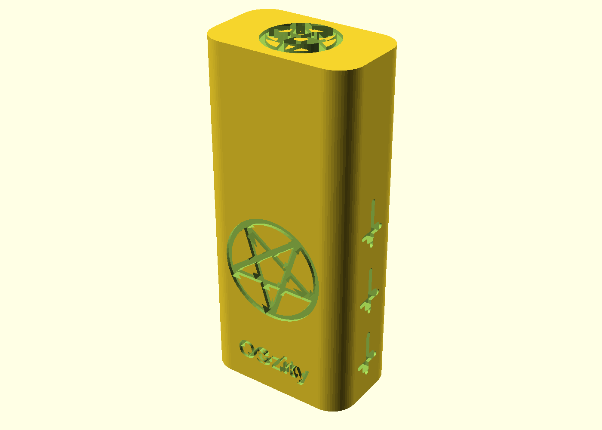
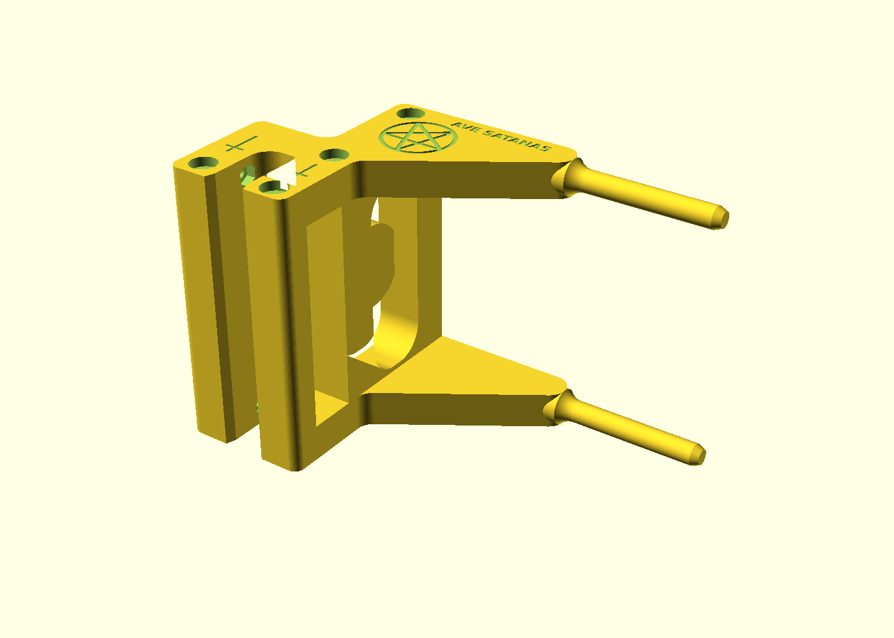
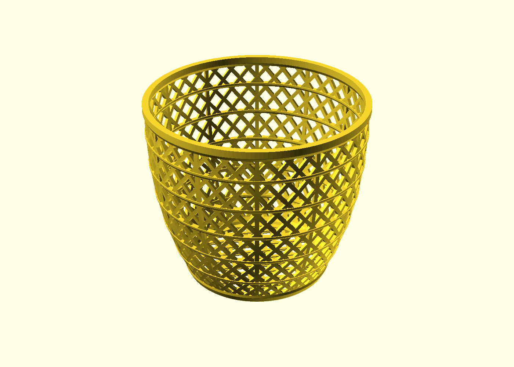

# Baelyn Blackmore: CAD Designs

**Software Engineer / CAD Designer**
Contact: baelyn.k.blackmore112895@outlook.com

Parametric, print ready part designs written in code. Most models here are built in OpenSCAD, so each one is a small program: change the numbers at the top, and the whole part rebuilds. Designed for FDM printing in PLA, with real parts, real fits and real failures worked through.

## At a glance

| Design | Version | What it shows | Size |
|---|---|---|---|
| [USB Drive Case](#1-usb-drive-case) | v2 | Two piece snap fit, engraved faces, no supports | 28 x 17 x 63 mm |
| [Aquarium Light Holder](#2-aquarium-light-holder) | v6 | Redesigned after a print failed under test, steel rods through the cross members | 137 mm reach, 91 mm tall |
| [Lattice Basket](#3-lattice-basket) | final | Dense woven lattice mesh | 175 x 175 x 150 mm |
| [Knuckle Goblet](#4-knuckle-goblet) | v16 | Three piece click lock, two colour print, engraved theme | about 200 mm tall |

## What this work shows

* **Design in code.** The `.scad` files are parametric, with named dimensions and derived values. The USB case and light holder also have built in checks that stop a bad combination of numbers before it prints.
* **Designing for the printer.** Parts are modelled in their print orientation, so layers run along the loaded direction.
* **Learning from failures.** The light holder went through six versions. When a test print tore apart along a layer line, the redesign added steel rods to carry that load.
* **Fits and tolerances.** Snap fits, captive nuts, sliding rods and press fits, each with a tuneable clearance number.
* **Multi part and multi colour.** Parts are split so each prints in its best orientation, with markings separated for a two colour print.
* **Detail work.** Engraved text, wrapped lettering and hand built vector motifs, all generated from code.

## Designs

### 1. USB Drive Case


A two piece case for a USB stick. The drive drops into the body, and the cap slides over a stepped rim and clicks on two small beads.

* Outside size: 28 x 17 x 63 mm
* Fit numbers (drive length, width, thickness) are parameters at the top of the file, so it adapts to any stick
* Engraved on all faces, with engraving depth and line width as parameters
* Prints with no supports: body standing on its floor, cap standing on its roof
* Print settings: 3 walls, 0.2 mm layers

Source: [`designs/usb_drive_case/usb_drive_case_v2_2.scad`](designs/usb_drive_case/usb_drive_case_v2_2.scad)

### 2. Aquarium Light Holder


A printed holder for an aquarium light, with two open truss rails, a framed web between them, and a hook that clamps over the glass. This is the sixth version, redesigned after a print was tested to failure.

**The problem.** One whole rail tore off along a layer line, exactly where the cross members meet it. On a printed part the layers are the weak direction, and the cross members were the only parts loaded across them.

**The fix.** Four hidden M4 threaded rods run through the cross members, with a nut sunk into each rail face. Steel now carries the loads that used to pull the layers apart, and tightening the nuts squeezes the layers together.

* Hardware: 4 x M4 threaded rod cut to 108 mm, 8 x M4 nuts
* Clamp screws moved up and seated in captive nuts, which cuts the bending lever on the leg to under half
* Leg root section is 178 percent of the previous version
* Big radius at the slot root on the leg side, where the part is in tension, and a small radius on the glass side so the glass still seats flat
* Print on its side, one rail flat on the bed, so every loaded member has its layers running along it

Source: [`designs/aquarium_light_holder/light_holder_v6_pentagram_2.scad`](designs/aquarium_light_holder/light_holder_v6_pentagram_2.scad)

### 3. Lattice Basket


A woven lattice basket with a solid rim and ribbed rings.

* Size: 175 x 175 x 150 mm
* Mesh: 248,540 triangles

Model: [`designs/basket/Basket_final.stl`](designs/basket/Basket_final.stl)

### 4. Knuckle Goblet

A tall goblet built from three printed pieces that click together: a foot, a handle and a cup. The loops of the handle drop into U shaped cradles on the foot and the cup, and two small nubs on each cradle wall snap into dimples in the handle faces.

* Assembled height about 200 mm, rim 143 mm across, foot 107 mm across
* Four finger loops on the handle, each sized on its own (21.0, 22.8, 24.6 and 24.0 mm)
* Two colour print: the markings print in one colour and the body in another
* Engraved bowl and foot with a Day of the Dead theme: skull, marigolds, vines, flags and sparkles
* Snap fit is tuneable with three numbers: `fit`, `nub_out` and `dimple_d`
* Print each part separately with the `part` setting: foot flat on its base, handle laid flat, cup upside down on its rim
* The handle is imported from a separate STL that is not part of this repository, so the file renders the foot and cup without it. It also needs the Pirata One font.
* Version 16 of the design

Source: [`designs/goblet/knuckle_goblet_v16.scad`](designs/goblet/knuckle_goblet_v16.scad)

## How to use the files

1. Install [OpenSCAD](https://openscad.org) (free).
2. Open a `.scad` file.
3. Press **F5** to preview, **F6** to render, then **File, Export, Export as STL**.
4. Slice the STL in your slicer and print.

STL files, like the basket, can go straight into a slicer.

## Notes

Extra reference notes are in the [`notes`](notes) folder.

## Repository layout

```
3Ddesigns/
  README.md
  designs/
    usb_drive_case/
    aquarium_light_holder/
    basket/
    goblet/
  images/
  notes/
```
