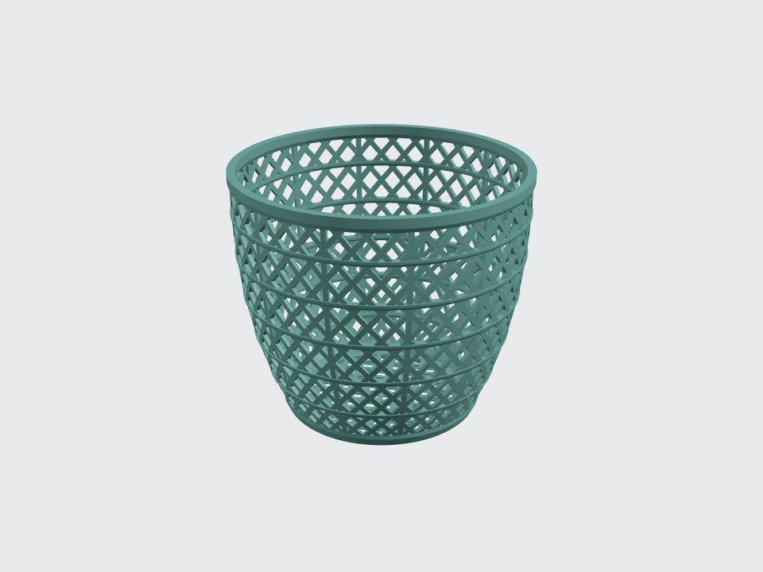
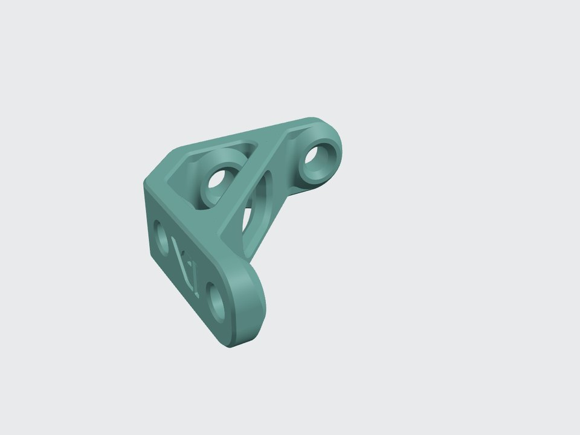
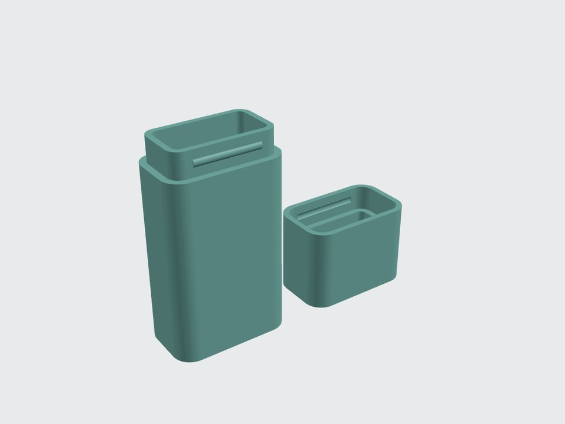
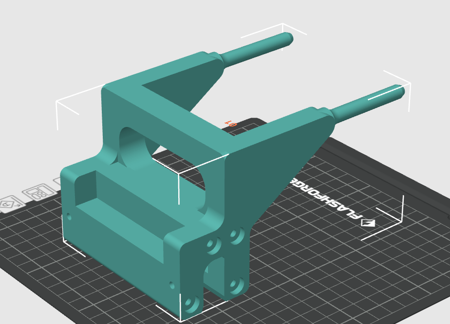
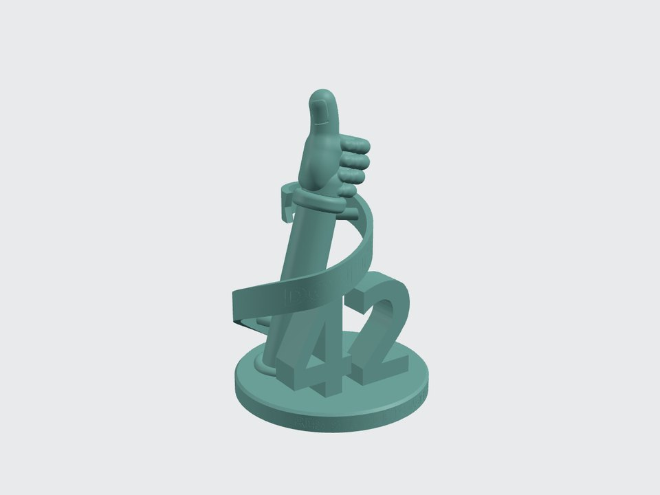
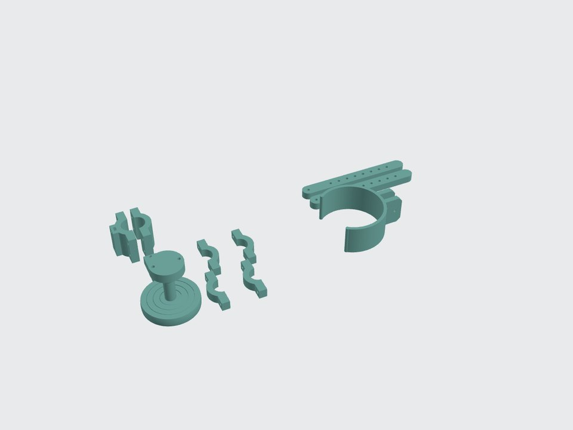
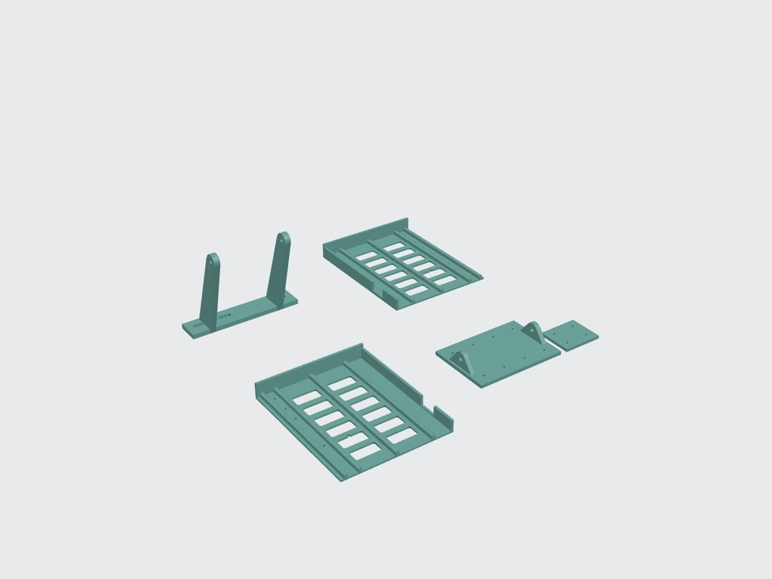
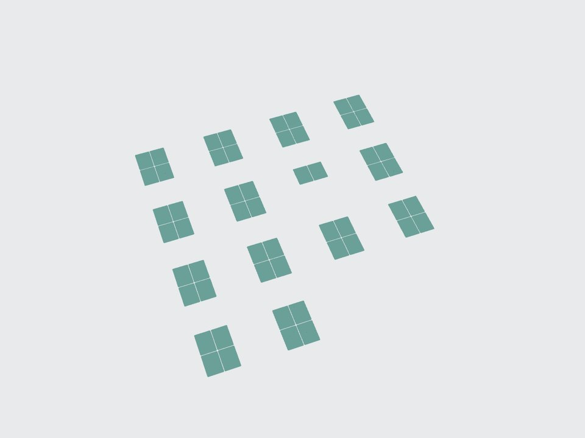

# 3D Designs

Pictures of parametric parts designed in OpenSCAD and printed on a Bambu P1S. Portfolio: https://ozzyti.github.io/Portfolio/

| | |
|---|---|
|  |  |
| Parametric lattice basket | Strong corner bracket |
|  |  |
| USB drive case | Aquarium light holder (client work) |
|  |  |
| 42 Don't Panic sculpture | Gyro forearm brace |
|  |  |
| Truck laptop mount | Playing cards |

## Game

[Play The Freeze Frame beta](https://ozzyti.github.io/Portfolio/game/) in your browser. A larger version is coming soon.

## Custom parts

Need a part designed? baelyn.k.blackmore112895@outlook.com
